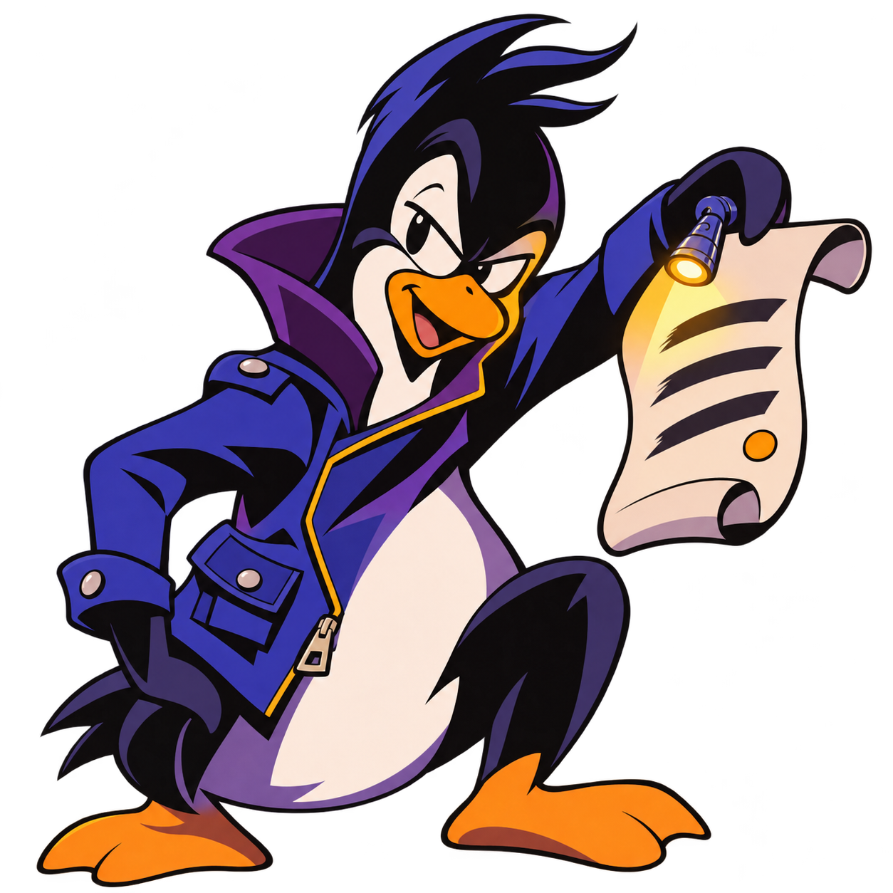
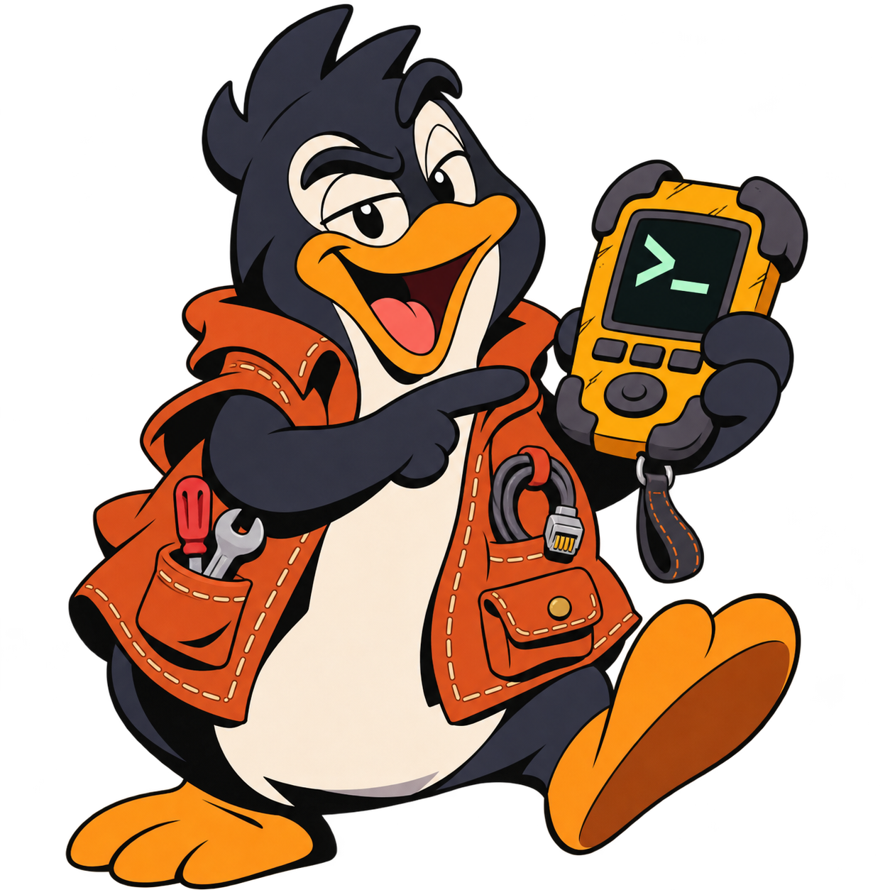
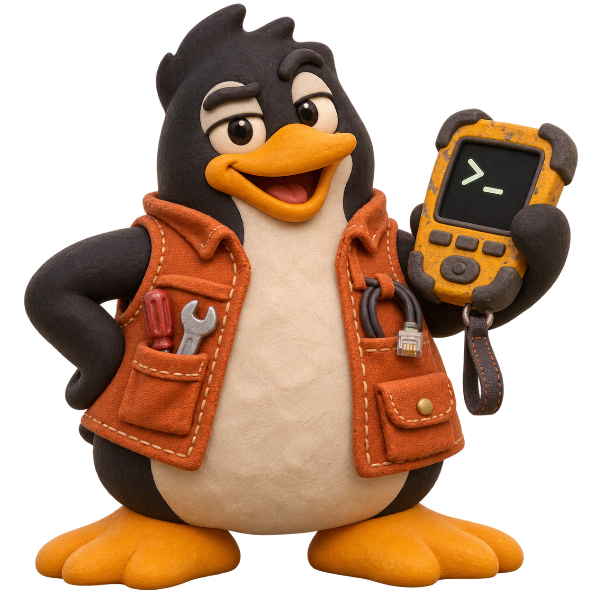
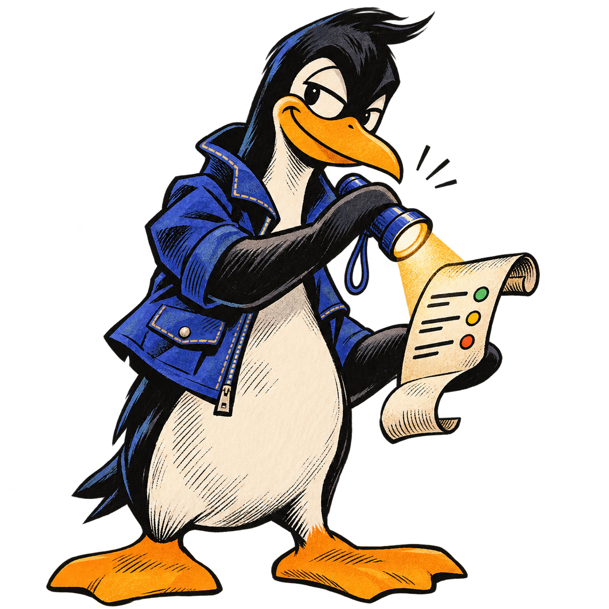
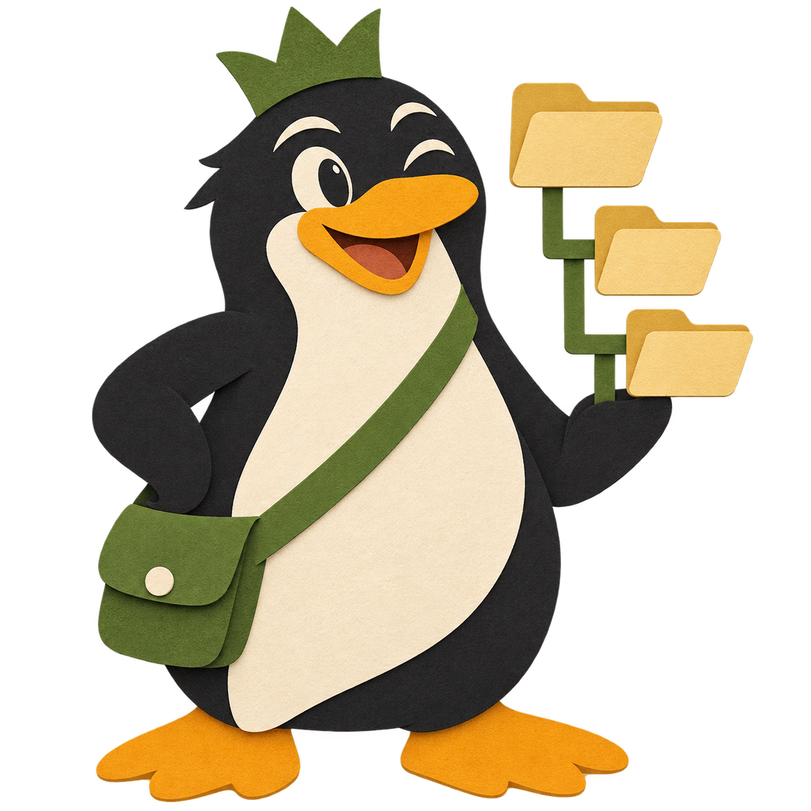
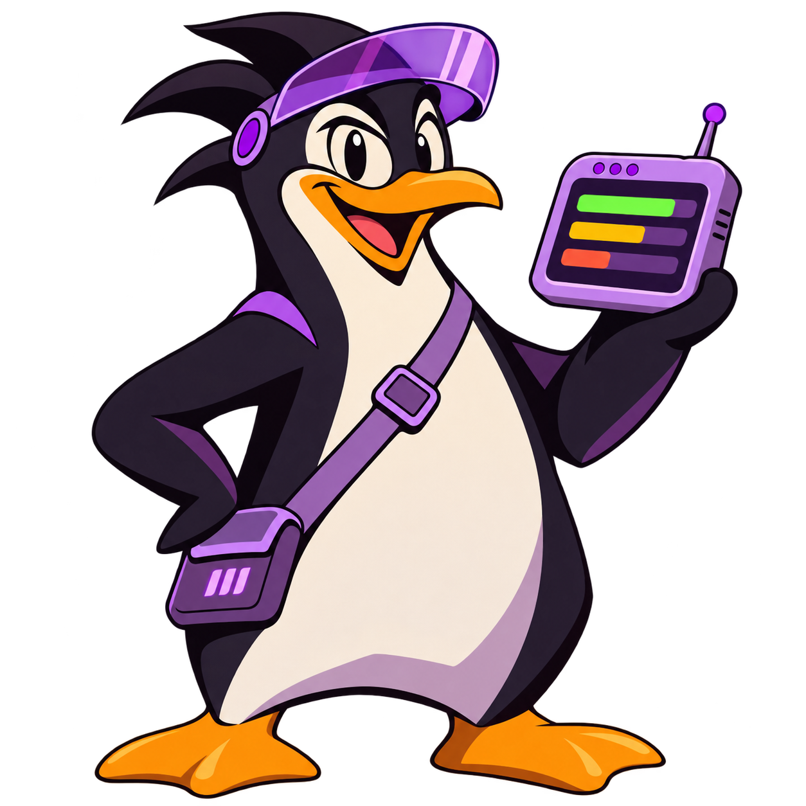

# Koncepter til LUPs Linux-pingvin

## Anden runde · Håndtegnet 90’er-tegnefilm

To af figurerne er gentegnet med kraftigere konturer, flade farver og mere bevægelse. Logdetektiven trækker på Darkwing Ducks teatralske detektivstemning, mens Terminalmekanikeren har det rundere udtryk fra en komisk eventyrtegneserie.

| Forhåndsvisning | Variant i fuld størrelse | Oplagt brug i undervisningen |
| --- | --- | --- |
|  | [Logdetektiven](06-logdetektiven-cel.png) | Følg sporene i en logfil. |
|  | [Terminalmekanikeren](07-terminalmekanikeren-cel.png) | Prøv din første terminalkommando. |

## Første runde · Fem designretninger

Koncepterne er første visuelle iteration til [issue #95](https://github.com/Mercantech/LUP/issues/95). Navnene her beskriver designretningerne. Alle fem har Tux' farver som fælles afsæt og giver Linux-guiden sin egen silhuet og rekvisit.

| Forhåndsvisning | Koncept i fuld størrelse | Oplagt brug i undervisningen |
| --- | --- | --- |
|  | [Terminalmekanikeren](01-terminalmekanikeren.png) | Første terminalkommando og praktisk fejlfinding. |
|  | [Logdetektiven](02-logdetektiven.png) | Læs en log og find den første fejl. |
|  | [Shell-pingvinen](03-shell-pingvinen.png) | Kom i gang med shell og kommandoer. |
|  | [Filsystemguiden](04-filsystemguiden.png) | Forstå mapper, stier og hvor man står i filsystemet. |
|  | [Procespiloten](05-procespiloten.png) | Se, hvilke processer der kører og bruger ressourcer. |

Billederne er originale konceptillustrationer genereret med den indbyggede OpenAI ImageGen. Hver kildefil er en transparent PNG på 1254 × 1254 px.

## Prompts

Hver generation fik den fælles prompt efterfulgt af prompten for den valgte retning.

### Fælles prompt

Use case: stylized-concept. Generate a single original full-body penguin mascot concept for LUP, a Danish IT vocational school's Linux teaching materials. A knowing, friendly guide with enough personality for teenage and adult learners. A recognizable nod to Tux through charcoal-black back and head, large cream-white bib, substantial orange-gold beak and broad orange-gold webbed feet. Invent the face, standing pose and silhouette for this character. Single mascot, centered at generous scale, smooth legible outer silhouette, both feet entirely inside frame, square composition with 12% margins, genuinely transparent background, crisp edges with no backdrop and no cast shadow beyond the character, no title, no lettering, no watermark, no brand mark, no collage, no other character. One strong practical Linux teaching prop, integrated into the pose.

### Terminalmekanikeren

Style: sculpted stop-motion plasticine with fingerprints, subtle cloth texture, soft studio illumination and real handcrafted seams. Penguin is a wide, squat terminal repair apprentice with a raised eyebrow, an asymmetrically scalloped crown and a burnt-orange utility vest open over the distinctive white bib. One flipper holds a stumpy battered handheld terminal like a multimeter, tilted toward the viewer, whose dark screen carries just the simple graphic prompt chevron followed by an underscore. Make this look like a frame from an artisan clay animation, softly lit three-dimensional shapes that can also read at small size.

### Logdetektiven

Style: highly distinctive European ink-and-gouache adventure comic, thick expressive black contours, angular brushwork, sparse ochre and ultramarine accents and elegant screenprint hatching. Tall narrow penguin with a swept feather at its crown, big flat orange feet and a deerstalker-free practical cropped cobalt jacket over a white bib. In a forward-leaning investigative pose it raises a tiny cobalt inspection light that illuminates a curling log strip in the other flipper, with just a few horizontal marks and geometric status dots. One strong intelligent side-eye. Hand-drawn editorial illustration, mature and punchy.

### Shell-pingvinen

Style: authentic hand-placed 16-bit pixel art, crisp hard square pixel clusters, no antialiasing or gradient glow, carefully limited dark teal, mint, cream and warm orange palette, intentionally coarse enough to read as a 96 by 96 pixel sprite enlarged by nearest neighbor. A compact forward-striding penguin with chunky squared-off flippers, oversized saffron webbed feet and an expressive angled cream eye patch. A tiny fold-out clamshell Linux terminal tucked close to the belly, mint screen with prompt chevron and underscore only. Charming, purposeful sprite with a legible head contour at emoji size.

### Filsystemguiden

Style: Scandinavian layered cut-paper illustration, bold flat planes of deeply matte charcoal, creamy warm white, saffron feet and fern green accents. Subtle fibrous tactile paper with only shallow layer depth. Original upright pear-shaped penguin with a ruffled three-point crown, one almond eye winking and a simple green shoulder satchel. It holds up three cascading, tabbed paper folders arranged in a single compact branching structure like a filesystem, with no text, held close to its body. Broader asymmetric cream bib, expressive pose, graphic enough for a sticker.

### Procespiloten

Style: retrofuturistic animation cel with emphatic graphic silhouettes, clean flat cel shading and sleek organic angles. A spry wedge-shaped black and white penguin with swept-back feather tufts, a confident grin, golden feet, and a lifted translucent violet pilot visor above clear eyes. In one flipper it holds a small lilac process monitor with three simple colored horizontal bars at different lengths. Eyes and silhouette stay paramount. Deep aubergine shadows and small ultraviolet accents, evocative of classic sci-fi animation, an upbeat systems operator, full-body and clearly penguin.

## Prompts til anden runde

Kildeillustrationerne fra første runde blev brugt som billedreferencer i den indbyggede OpenAI ImageGen. Hver generation fik den fælles prompt efterfulgt af prompten til den enkelte figur. Begge resultater er transparente PNG-filer på 1254 × 1254 px.

### Fælles prompt

Use case: stylized-concept, image-to-image character design variation. Redraw the supplied original LUP Linux penguin as an expressive hand-drawn character from a kinetic Disney afternoon 2D TV action comedy circa 1991. Use the confident theatrics, animated acting, strong silhouette, thick-to-thin hand-inked contours, clean flat cel colors and deep graphic shadow shapes of that period. Keep the unmistakable original penguin anatomy and Tux color cue: round charcoal body with a genuinely white/off-white belly, short broad orange beak rather than a duck bill, orange webbed feet, penguin flippers, three crown feathers. This is an original Linux teaching mascot, not an existing show character. No broad-brimmed hat, superhero eye mask, replica costume, third-party logos or text labels. A single isolated full-body mascot, one dominant silhouette, preserve all feet and props with ample empty margin, square frame, true alpha-transparent background, no scene or cast shadow, no text or caption. High-end clean 2D production cel, not 3D rendering or realistic surface textures.

### Logdetektiven

[Billedreference](02-logdetektiven.png)

Input image role: original character identity and teaching-prop reference. Take this Log Detective into a flamboyant action-noir cartoon direction inspired by the playful suspense and posing of Darkwing Duck. Preserve cobalt jacket, pen-like swept crown and Linux log as the core identifiers. Invent an off-center asymmetrical cobalt utility jacket with a high plum stand collar and one bright seam, pocket shape visible, no cape. A theatrical low crouch with flipper braced against one knee, comically narrowed eyes and one raised brow, answering a puzzling log error; the other flipper presents a single tiny inspection light visibly clipped to the curling log strip. Three broad abstract dark marks on that paper and one amber dot only. A deliberately shortened wedge-shaped orange beak distinct from a duck. Strong cobalt and violet shadow shapes with a small warm amber highlight from the light on the cheek and paper; no environmental effects. Make the original Linux detective feel like a fast, funny, slightly overdramatic protagonist caught mid-case.

### Terminalmekanikeren

[Billedreference](01-terminalmekanikeren.png)

Input image role: original character identity, orange gilet and handheld terminal reference. Reimagine this Terminal Mechanic as the brighter and more comedic lead of a 1990s Disney hand-drawn TV adventure. Maintain short stocky body, loose rust-orange mechanics vest worn open, tiny stitched pocket details, black three-point crown, expressive eyebrows, white belly and sturdy amber handheld terminal. Make the face delightfully cheeky with one lifted brow, half-lidded eyes and a wide triangular penguin grin. Full body, lean into a springy forward step with one foot planted and the other slightly lifted, left flipper holds the old-school rugged terminal close at chest height and the other flipper gestures at its screen. Only display the graphic >_ on screen, no other lettering. Clean flat cel tones with dark petrol blue-black, rusty orange and mint screen, plus one clear solid shadow per form. Bold, rounded and squash-and-stretch cartoon acting, very distinct from the detective's narrower personality.
